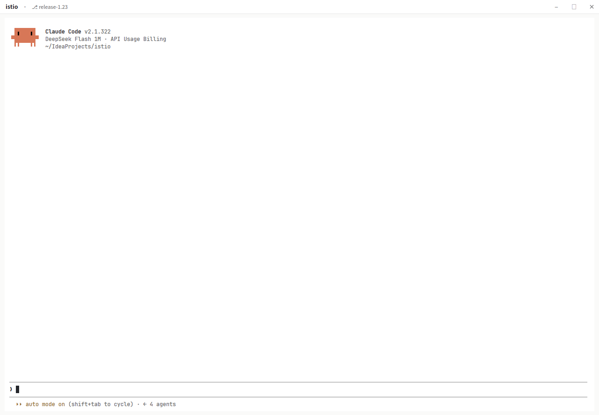

# pure

A layout for [Herdr](https://herdr.dev) with no chrome: the window is the terminal.

Herdr's own layouts (`main`, `terminals`, `win98`) all keep a tab strip, a status bar and
cards around the panes. `pure` drops all three and leaves the terminal alone. Herdr still runs
the terminals and agents; `pure` is only what gets drawn.



## Install

Install [Herdr](https://herdr.dev/download/), then ask the agent in any Herdr terminal:

```
Add the layout at github.com/ktalg/herdr-app-pure-layout
```

Or copy it yourself:

```sh
cp layouts/pure.json layouts/pure.svg ~/.config/herdr-app/layouts/
cp -r mods/pure-bar ~/.config/herdr-app/mods/
herdr-app do layout.switch --name pure
```

`ctrl-shift-l` cycles layouts, so Herdr's own stays one key away.

## What it adds to Herdr

- **No tab strip, no status bar, no panel buttons.** Nothing sits between the window edge and
  the terminal.
- **A single pane has no frame.** No border, no pane header, no accent — just the terminal.
- **Splits look like splits.** Two or more panes get a thin border, a gap and a small header each;
  the one with the keyboard takes the accent colour.
- **The sidebar is still there.** Herdr's own `spaces` and `agents` lists, hidden when the layout
  loads and one key away after that.
- **Your theme.** Every colour is a theme token, so light and dark themes both work.

Tabs and spaces work exactly as in Herdr: `alt-[` / `alt-]` for tabs, `alt-1..9` for spaces,
`ctrl-1..9` to jump to a tab, the sidebar for the rest.

## Repository

| Path | What |
|---|---|
| `layouts/pure.json` | the layout |
| `layouts/pure.svg` | preview for Herdr's settings screen |
| `mods/pure-bar/` | the bar at the top: workspace, branch, worktree, window buttons |
| `RECIPE.md` | the brief to rebuild it from scratch (Herdr's sharing format) |
| `preview.png` | the screenshot above |
