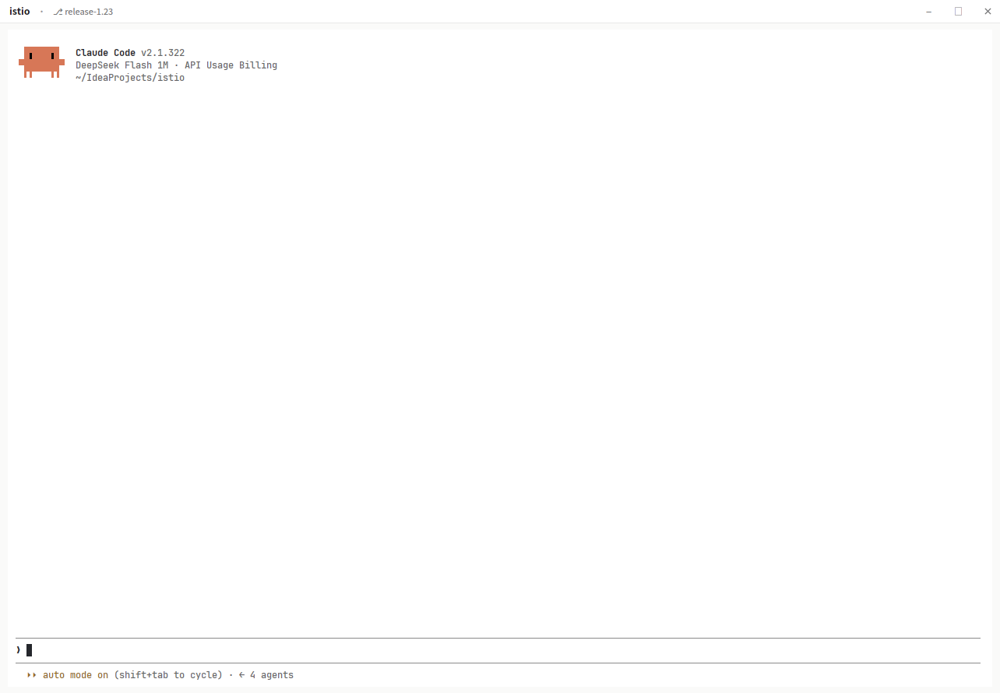

# pure

A Herdr layout. The window gets a 30px bar above the panes, and Herdr's own sidebar stays closed until you open it.

## Layout

The root is one row of two columns with `titlebar: "none"`, so the window draws its own bar.

Sidebar: 268px (min 44, max 480), `chrome` background. It's Herdr's `main` sidebar, unchanged:
`brand` (46px, also the window drag area), `sidebar-lists` with `spaces` and `agents` (half each,
min 90px), `sidebar-footer` (69px). The layout sets `hidden: true`, and `ctrl-shift-b` toggles it.

Content: `canvas` background.

- `bar`, 30px, mod `pure-bar`: workspace name, `⎇ branch`, `worktree of <repo>` when the folder is
  a linked worktree, `@ machine` for remote panes, and `− □ ⨯` on the right. The strip between
  them is `window_drag: true`.
- `main`, padding `[8, 10]`: the panes of the active tab. `lone: false`, so a single pane is drawn
  without a frame or a header. With two or more panes, each gets a 1px `border`, 8px gaps and a
  30px header, and the pane with the keyboard gets an `accent` border.

## What the title bar shows

The workspace name comes from the space. The branch and the worktree come from the focused pane,
which is how WezTerm (`tab.active_pane`), tmux (`automatic-rename`) and Sinclair (focused pane's
working directory) do it:

| Case | Title bar |
|---|---|
| one pane in a checkout | `api · ⎇ feat/login` |
| two panes on the same branch | `api · ⎇ main` |
| two panes on different branches | `api · ⎇ feat/a · 2 branches` |
| two folders, neither a repo | `api · 2 folders` |
| the folder is a linked worktree | `api · ⎇ feat/x · worktree of main-repo` |
| a pane on another machine | `api · ⎇ main · @ vps` |
| no space open | `Herdr` |

If the tab's panes disagree, the bar says how many.

The worktree check runs `git rev-parse --show-toplevel` and
`git rev-parse --path-format=absolute --git-common-dir` for the focused pane's folder, once per
folder. Different `.git` paths mean a linked worktree; the repo name is the folder that owns the
shared `.git`.

## Install

Ask your Herdr agent to add `herdr.dev/layouts/ktalg/herdr-app-pure-layout`.

By hand: copy `layouts/pure.json`, `layouts/pure.svg` and `mods/pure-bar` into `~/.config/herdr-app/`,
then switch to it with `ctrl-shift-l`. Needs Herdr app 0.1.15 or newer.

## Files

| Path | What it is |
|---|---|
| `layouts/pure.json` | sidebar, title bar, pane area |
| `layouts/pure.svg` | preview for Herdr's settings screen |
| `mods/pure-bar/main.js` | the bar: workspace, branch, worktree, window buttons |
| `mods/pure-bar/mod.json` | `{ "place": "none" }`, so it only appears where the layout puts it |

No keys are added or changed.
